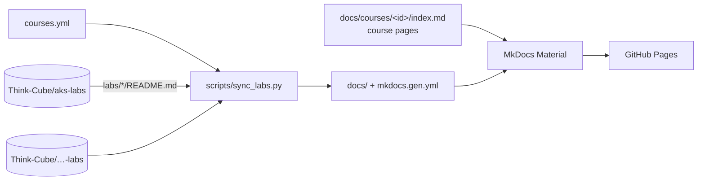

# Think-Cube Trainings

Source of the trainings catalog site – course pages plus lab instructions pulled from the course repositories (`*-labs`).

**Site:** https://think-cube.github.io/trainings/

## How it works



- **Lab instructions stay in their own repositories.** The build downloads them (no git needed), rewrites relative links to GitHub and generates the navigation.
- The site is rebuilt on every push, **every night**, and on demand (*Actions → Build and publish → Run workflow*).
- Generated files (`docs/index.md`, `docs/courses/*/labs/`, `mkdocs.gen.yml`) are not committed.

## Add a course

1. Move the lab repository to Think-Cube as `<topic>-labs` with instructions in `labs/LABnn-<name>/README.md`.
2. Add an entry to `courses.yml` (`id`, `title`, `nav_title`, `summary`, `duration`, `level`, `labs_repo`).
3. Create `docs/courses/<id>/index.md` – the course description (copy `docs/courses/aks/index.md` as a template).
4. Commit, push, merge – the site updates in about a minute.

A course without `labs_repo` appears on the home page as *Coming soon* and needs no course page yet.

## Run locally

```bash
python -m venv .venv && . .venv/bin/activate      # Windows: .venv\Scripts\Activate.ps1
pip install -r requirements.txt
python scripts/sync_labs.py
mkdocs serve -f mkdocs.gen.yml                    # http://127.0.0.1:8000
```

## One-time setup

1. **Settings → Pages → Build and deployment → Source: GitHub Actions.**
2. Optional custom domain, e.g. `trainings.thinkcube.dev`:
   - DNS: `CNAME trainings → think-cube.github.io`
   - **Settings → Pages → Custom domain**, tick *Enforce HTTPS*
   - set `site_url` in `mkdocs.yml` to the new address
